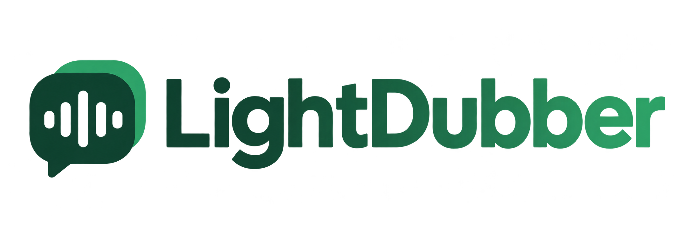
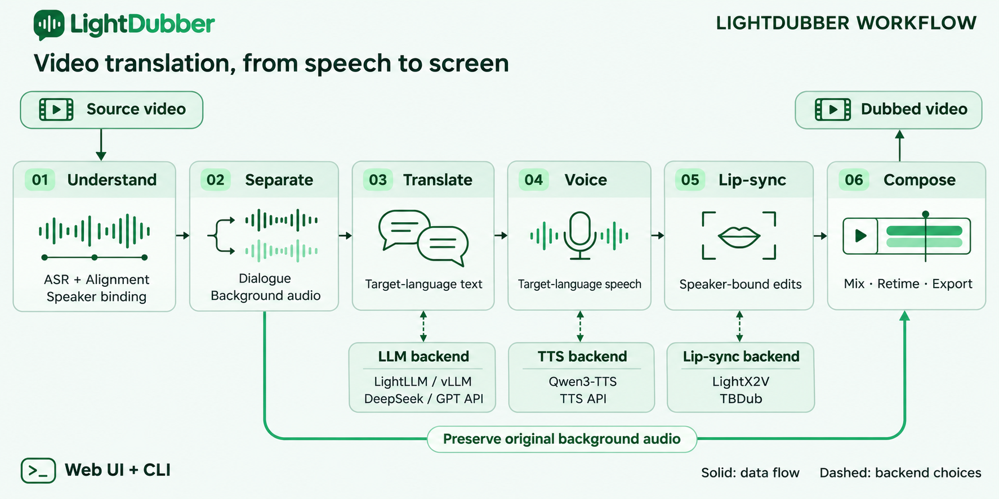

<p align="center">
  <picture>
    <source media="(prefers-color-scheme: dark)" srcset="docs/assets/lightdubber-logo-v3-dark.png" />
    
  </picture>
</p>

<h3 align="center">Video translation, with each speaker in the picture.</h3>

<p align="center">
  Translate dialogue, generate voices, and edit lip motion in one modular pipeline.<br />
  Run local models or connect your own translation and TTS APIs.
</p>

<p align="center">
  <strong>English</strong> · <a href="README.zh-CN.md">简体中文</a>
</p>

<p align="center">
  <a href="#quick-start"></a>
  <a href="#features"></a>
  <a href="https://github.com/ModelTC/LightX2V"></a>
</p>

<p align="center">
  <a href="#features">Features</a> ·
  <a href="#demo">Demo</a> ·
  <a href="#pipeline">Pipeline</a> ·
  <a href="#quick-start">Quick start</a> ·
  <a href="docs/installation.md">Installation & APIs</a>
</p>

---

**LightDubber** is a video translation and dubbing framework for single-speaker videos and multi-person conversations. It connects speech recognition, audiovisual speaker binding, translation, voice synthesis, lip-sync, and final composition. Each stage has its own model adapter, so you can replace a model or use an API without rewriting the pipeline.

<a id="features"></a>
## Features

| | What it does |
| :-- | :-- |
| **Speaker-aware dubbing** | Associates dialogue with visible speakers and uses reference audio for local voice cloning. |
| **Multilingual output** | Supports 10 target languages, with automatic source-language detection. |
| **Flexible model backends** | Uses LightLLM for local translation and LightX2V for lip-sync; translation and TTS also support OpenAI-compatible APIs. |
| **Adaptive timing** | Fits speech to the original video or adjusts eligible video segments to the translated speech. |
| **Web UI and CLI** | Upload videos, queue jobs, inspect results, or run the same pipeline from the command line. |

**Languages:** Chinese · English · Japanese · Korean · German · French · Russian · Portuguese · Spanish · Italian

<a id="demo"></a>
## Demo

**Chinese → English**

<table>
<thead>
<tr>
<th align="center" width="50%">Original · Chinese</th>
<th align="center" width="50%">LightDubber · English</th>
</tr>
</thead>
<tbody>
<tr>
<td width="50%" align="center" valign="top">

https://github.com/user-attachments/assets/83d17d3e-f1da-455e-b217-6ded433ff221

</td>
<td width="50%" align="center" valign="top">

https://github.com/user-attachments/assets/ffc9e8b9-be30-41cf-aec9-19c4e5c4f54e

</td>
</tr>
</tbody>
</table>

<a id="pipeline"></a>
## Pipeline

<p align="center">
  
</p>

**Recognize & bind → Separate → Translate → Synthesize → Lip-sync → Compose.**

ASR and alignment recover dialogue and timing; visual speaker binding associates each line with a character. Audio separation retains background sound, while translation and TTS produce new dialogue. LightX2V edits the selected face regions, then the pipeline mixes audio and composites the final video. Dialogue without a suitable visible face receives audio dubbing without a mouth edit.

<a id="quick-start"></a>
## Quick start

Requires **Linux, CUDA GPUs, FFmpeg, `curl`, `unzip`, and `uv`**. The example below uses local translation and TTS. **Translation can also use DeepSeek, OpenAI GPT, or another OpenAI-compatible API**—no local LightLLM/vLLM environment, Qwen3.5 weights, or translation GPU is needed. See [API setup and examples](docs/installation.md#api-backends).

### 1. Install

```bash
git clone https://github.com/ModelTC/LightDubber.git
cd LightDubber
bash scripts/install.sh --translation lightllm
```

The installer prepares the pipeline and local TTS environments; `--translation lightllm` also installs the local translation server. Local Qwen3-TTS currently uses a separate Python environment because its Transformers dependency differs from the pipeline's. You do not need to manage that environment manually. API TTS can skip it with `--tts api`.

Lip-sync requires a [LightX2V](https://github.com/ModelTC/LightX2V) installation with native TBDub support. Follow the [model-service setup](docs/installation.md#model-services) before launching jobs.

### 2. Download and configure

```bash
export MODEL_DIR=/path/to/models/video_dubbing
PYTHON_BIN="$PWD/.venv/bin/python" bash scripts/download_models.sh all
.venv/bin/python scripts/configure.py --models "$MODEL_DIR" --output config.local.json
```

[config.example.json](config.example.json) lists model paths and backend options. The generated local configuration is ignored by Git. See [model downloads](docs/installation.md#model-downloads) for individual components and download sources.

### 3. Start the model services

Start [LightLLM and LightX2V](docs/installation.md#model-services) in separate terminals. The documented example uses GPU 0 for translation, GPU 1 for lip-sync, and GPUs 2–3 for pipeline workers. Configure the GPU IDs and model paths for your machine.

| Service | Default address |
| :-- | :-- |
| Translation · LightLLM | `http://127.0.0.1:18440/v1` |
| Lip-sync · LightX2V | `http://127.0.0.1:18441` |

### 4. Translate a video

Start the web UI after the model services are ready:

```bash
DUB_GPUS=2,3 DUB_CONFIG="$PWD/config.local.json" \
  DUB_DATA_DIR="$PWD/outputs/web" bash scripts/serve.sh
```

Open **http://127.0.0.1:18320**, wait for worker model loading, then upload a video and choose the target language. Use `DUB_GPUS=2` for a single pipeline worker.

Or run the CLI on an idle pipeline GPU:

```bash
.venv/bin/python main.py \
  --config config.local.json --gpu 2 \
  --source input.mp4 --target-language en \
  --output outputs/example_en
```

See [usage options](docs/installation.md#usage-options) for duration modes, uploads, public access, and resuming jobs.

## Results and development

Each job writes `final.mp4`, `source.txt`, `translated.txt`, `report.json`, and execution logs. The report includes separate translation and TTS timings. Web jobs are saved under `$DUB_DATA_DIR/jobs/<id>/`.

<details>
<summary>Code layout and stage interfaces</summary>

```text
main.py                  CLI entry point
runtime/                 Pipeline, configuration, clients, resident processes
stages/
  prepare/               Normalize video and audio
  recognition/           ASR, alignment, acoustic speaker labels
  speakers/              Face detection, active speaking, identity binding
  separation/            Dialogue/background separation
  speech/                Translation and voice synthesis
  lipsync/               Crop planning and LightX2V requests
  postprocess/           Mix, composite, retime, export
web/                     Uploads, job queue, result viewer
scripts/                 Installation, downloads, service launchers
```

The CLI and web workers share `Pipeline`. Model stages expose `run_stage(...)` in `run.py`, model/service adapters in `model.py`, and helpers in `utils.py`. Export stages keep focused audio and video modules. `runtime/paths.py` owns job artifact paths. S3FD, LoCoNet, and SAM-Audio inference code lives with the stages that use it.

TTS reuses audio for identical requests and stops shortening retries that no longer improve timing. Face detection caches fixed-shape prior boxes and overlaps frame encoding with detection. CPU regression tests cover caching, stage dispatch, and resume:

```bash
.venv/bin/python -m unittest discover -s tests -v
```

</details>

## Acknowledgements

Built with [LightX2V](https://github.com/ModelTC/LightX2V), [LightLLM](https://github.com/ModelTC/LightLLM), and the upstream models listed in [SOURCES.json](SOURCES.json). Original licenses and notices are preserved in [licenses/](licenses/). [vLLM](https://github.com/vllm-project/vllm) is available as an alternative local translation backend.
