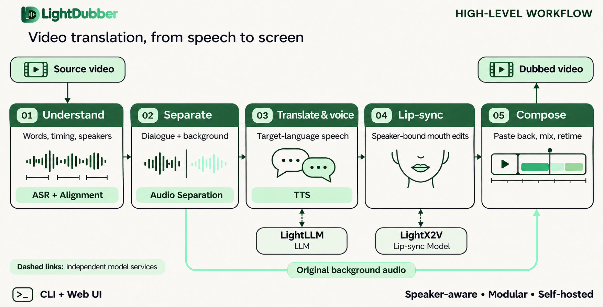

  

<h3 align="center">Speaker-aware video translation and dubbing</h3>

  <strong>English</strong> · <a href="README.zh-CN.md">简体中文</a>

  
  
  
  

  <a href="#showcase">Showcase</a> ·
  <a href="#pipeline">Pipeline</a> ·
  <a href="#quick-start">Quick start</a> ·
  <a href="#deployment">Model servers</a> ·
  <a href="#usage">Web UI & CLI</a>

---

**LightDubber** is a powerful video dubbing framework built for **multi-speaker conversations and multilingual storytelling**. It brings together speaker-aware voice cloning, localized lip-sync, and adaptive timing to carry a video's dialogue across languages while keeping its characters and visual identity at the heart of the experience. From solo presenters to multi-person scenes, upload a video and bring your story to a new audience.

**Languages:** Chinese · English · Japanese · Korean · German · French · Russian · Portuguese · Spanish · Italian  
Source language is detected automatically by default; the target language is explicit.

## Showcase · Chinese → English

### Case 01

<!-- One case per row: original on the left, LightDubber on the right. To change a video, upload its MP4 in the GitHub editor and replace the corresponding URL below. Keep each attachment URL on its own line, with blank lines around it and outside HTML comments. The same URLs can be reused in README.zh-CN.md. -->

<table>
<thead>
<tr>
<th align="center" width="50%">Original · Chinese</th>
<th align="center" width="50%">LightDubber · English</th>
</tr>
</thead>
<tbody>
<tr>
<td width="50%" align="center" valign="top">

https://github.com/user-attachments/assets/83d17d3e-f1da-455e-b217-6ded433ff221

</td>
<td width="50%" align="center" valign="top">

https://github.com/user-attachments/assets/ffc9e8b9-be30-41cf-aec9-19c4e5c4f54e

</td>
</tr>
</tbody>
</table>

## Pipeline

  

**ASR + alignment** recover dialogue and timing, while audiovisual speaker binding associates each line with an on-screen character. **Audio separation** isolates dialogue from the background; an **LLM** served through **LightLLM** translates the text, **TTS** generates the target-language voices, and a lip-sync model served through **LightX2V** edits mouth motion locally. Compositing brings the new dialogue, edited regions, and background audio together. These are module roles, not fixed model choices; the setup below documents the current implementations.

> Model outputs are estimates, not guarantees of verbatim translation, clean separation, or perfect synchronization. When no suitable visible face can be bound, the pipeline replaces audio without forcing a mouth edit. Execution failures are reported as failures.

## Quick start

### 1. Prepare the environments

Requires Linux, CUDA GPUs, FFmpeg, `curl`, `unzip`, and `uv`. The published GitHub URL still uses the former `DubFlow` slug; the command below names the local checkout `LightDubber`. Run the remaining commands from that directory:

~~~bash
git clone https://github.com/ModelTC/DubFlow.git LightDubber
cd LightDubber

# Main pipeline: recognition, separation, visual binding, and web UI
bash scripts/install_unified.sh "$PWD/.venv"

# Qwen3-TTS: isolated Transformers 4.57 environment
uv venv --python 3.11 .venv-tts
uv pip install --python .venv-tts/bin/python \
  --index-url https://download.pytorch.org/whl/cu128 \
  torch==2.8.0+cu128 torchaudio==2.8.0+cu128
uv pip install --python .venv-tts/bin/python \
  qwen-tts==0.1.1 transformers==4.57.3 accelerate==1.12.0 soundfile

# Translation server: LightLLM (default)
git clone https://github.com/ModelTC/LightLLM.git ../LightLLM
uv venv --python 3.10 --seed .venv-lightllm
uv pip install --python .venv-lightllm/bin/python \
  -r ../LightLLM/requirements.txt \
  --extra-index-url https://download.pytorch.org/whl/cu124
LIGHTDUBBER_ROOT="$PWD"
(cd ../LightLLM && "$LIGHTDUBBER_ROOT/.venv-lightllm/bin/python" setup.py install)
~~~

Install a **[LightX2V](https://github.com/ModelTC/LightX2V) checkout with native TBDub support** in a separate environment, following that repository's instructions. Its environment also needs `scikit-image` for color correction.

For the optional vLLM backend, create a separate environment:

~~~bash
uv venv --python 3.11 .venv-vllm
uv pip install --python .venv-vllm/bin/python vllm==0.23.0
~~~

To use it, set `translation_backend` to `vllm` in `config.local.json` and start Terminal 1 with `VLLM_BIN="$PWD/.venv-vllm/bin/vllm"`. The [LightLLM installation guide](https://lightllm-en.readthedocs.io/en/latest/getting_started/installation.html) has GPU and shared-memory requirements.

These environments are intentionally separate because of dependency constraints. The main installation script links FFmpeg libraries; the pipeline sets the library search path when launching stages.

### 2. Download the models

Accept any required model access terms and use `.venv/bin/hf auth login` when authentication is needed. Keep credentials out of source files.

~~~bash
export MODEL_DIR=/path/to/models/video_dubbing
PYTHON_BIN="$PWD/.venv/bin/python" bash scripts/download_models.sh all
~~~

This downloads the current model stack and its auxiliary weights; model files are not included in this repository. SAM-Audio Large-TV uses ModelScope by default. Set `SAM_AUDIO_DOWNLOAD_SOURCE=hf` to use Hugging Face.

Download individual components

~~~bash
# Replace "all" with one of these component groups:
# core                 TBDub Student, VAE, HuBERT, face detection/geometry/identity
# speech               Qwen ASR, ForcedAligner, Nemotron, Qwen3-TTS
# loconet              UniTalk-LoCoNet active-speaker weights
# sam-audio            SAM-Audio Large-TV and its text encoder
# qwen35-translation   Qwen3.5-9B
PYTHON_BIN="$PWD/.venv/bin/python" bash scripts/download_models.sh sam-audio
~~~

### 3. Generate a local configuration

~~~bash
.venv/bin/python scripts/configure.py \
  --models "$MODEL_DIR" \
  --python "$PWD/.venv/bin/python" \
  --tts-python "$PWD/.venv-tts/bin/python" \
  --output config.local.json
~~~

The template is [config.example.json](config.example.json). The local file is ignored by Git; use `--force` only when you intend to replace an existing configuration.

## Start the model servers

Example deployment using four GPUs:

| GPU | Process | Responsibility |
| :-- | :-- | :-- |
| 0 | LightLLM | Qwen3.5-9B translation |
| 1 | LightX2V | TBDub Student lip-sync |
| 2, 3 | LightDubber workers | One video request per worker; TTS stays in a separate resident process on the same GPU |

Start each command in a separate terminal, from the LightDubber root. Set `MODEL_DIR` to the same model directory in each terminal; replace the LightX2V paths with your installation.

**Terminal 1 — translation**

~~~bash
GPU_ID=0 MODEL_PATH="$MODEL_DIR/Qwen3.5-9B" \
  LIGHTLLM_PYTHON="$PWD/.venv-lightllm/bin/python" \
  bash scripts/serve_translation.sh
~~~

**Terminal 2 — lip-sync**

~~~bash
GPU_ID=1 LIGHTX2V_PATH=/path/to/LightX2V \
  PYTHON_BIN=/path/to/lightx2v-env/bin/python \
  MODEL_PATH="$MODEL_DIR/tbdub" \
  CONFIG_PATH="$PWD/configs/tbdub_server.json" \
  bash scripts/serve_lipsync.sh
~~~

LightLLM is the default `translation_backend` in `config.local.json`, which the service script reads. To switch to vLLM, set this field to `vllm` so the service, pipeline, and Web UI agree. `TRANSLATION_BACKEND` overrides only the service process for testing. Default endpoints are `http://127.0.0.1:18440/v1` and `http://127.0.0.1:18441`, matching `translation_url` and `tbdub_url` in the configuration.

**LightX2V and LightDubber must see the same absolute media paths**, including when running in containers. Keep these internal model endpoints private. GPU memory requirements depend on the selected models and workload; the GPU IDs above are a deployment example, not a minimum-memory guarantee.

## Translate a video

### Web UI

**Terminal 3 — browser interface and pipeline workers**

~~~bash
DUB_GPUS=2,3 DUB_CONFIG="$PWD/config.local.json" \
  DUB_DATA_DIR="$PWD/outputs/web" bash scripts/serve.sh
~~~

Open **http://127.0.0.1:18320**, wait for model loading, then upload a video and select the target language. Two workers can process two video jobs concurrently; the shared lip-sync service queues crop requests. Set `DUB_GPUS=2` for one pipeline worker.

Optional: temporary public HTTPS access

With `cloudflared` installed:

~~~bash
CLOUDFLARED_BIN=/path/to/cloudflared PORT=18320 bash scripts/public.sh
~~~

Use the HTTPS URL printed in the terminal. Anyone with the link can upload and trigger inference; share it only with intended users. Stop the tunnel to remove access. Do not expose the translation or LightX2V endpoints.

Default uploads allow 1 GB per file and 8 MiB per request. The server saves confirmed progress every 2 MiB, so an interrupted request can resume from the last saved byte. Up to 16 uploads can run concurrently, independent of the video worker count. Adjust `DUB_MAX_UPLOAD_MB`, `DUB_UPLOAD_CHUNK_MB`, and `DUB_MAX_CONCURRENT_UPLOADS` when starting the web service.

### Command line

Start both model services first. Use an idle pipeline GPU, not one already assigned to a web worker:

~~~bash
.venv/bin/python main.py \
  --config config.local.json --gpu 2 \
  --source input.mp4 --target-language en \
  --output outputs/example_en
~~~

| Option | Behavior |
| :-- | :-- |
| `--target-language en` | Required output language: `zh/en/ja/ko/de/fr/ru/pt/es/it` |
| `--source-language zh` | Override automatic source-language detection |
| `--duration-mode adaptive_video` | Adapt eligible video and background-audio segments to speech duration; default configuration |
| `--duration-mode fixed` | Preserve video duration and fit translated speech into its time window |
| `--resume` | Resume the same request; use a new output directory after changing inputs or configuration |

### Results and logs

- `final.mp4` — delivered video; `final_fixed.mp4` is the pre-retiming intermediate in adaptive mode.
- `source.txt` / `translated.txt` — recognized and translated dialogue.
- `report.json` — audio replacement and lip-sync outcomes.
- `run.json` / `logs/` — pipeline progress and per-stage errors.

Web jobs live under `$DUB_DATA_DIR/jobs/<id>/`; resident model loading logs are under `$DUB_DATA_DIR/resident/`. Stop each foreground service with `Ctrl+C`.

Code layout

~~~text
main.py                  Pipeline orchestration
stages/
  prepare.py             Normalize video and audio
  recognition/           ASR, alignment, acoustic speaker labels
  speakers/              Detection, active speaking, identity binding
  separate.py            Dialogue/background separation
  speech/                Translation and voice synthesis
  lipsync/               Crop planning and LightX2V requests
  output/                Mix, paste back, retime, export
runtime/                 Configuration, clients, resident processes
web/                     Uploads, job queue, result viewer
scripts/                 Installation, downloads, service launchers
~~~

Both the CLI and web workers use `main.py`. Individual stage options are available with `python -m stages.<module> --help`.

---

Built with [LightX2V](https://github.com/ModelTC/LightX2V), [LightLLM](https://github.com/ModelTC/LightLLM) (or optional [vLLM](https://github.com/vllm-project/vllm)), and the upstream models recorded in [third_party/SOURCES.json](third_party/SOURCES.json). Original licenses and notices remain in [third_party/](third_party/) and [licenses/](licenses/). Model and input-media permissions apply separately; use voice cloning only with appropriate authorization.

<a href="#pipeline">Back to pipeline ↑</a> · <a href="README.zh-CN.md">简体中文</a>

