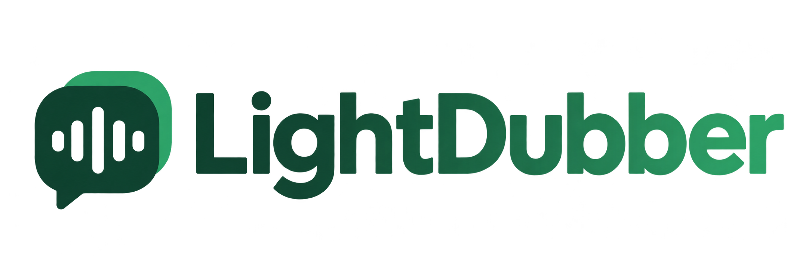
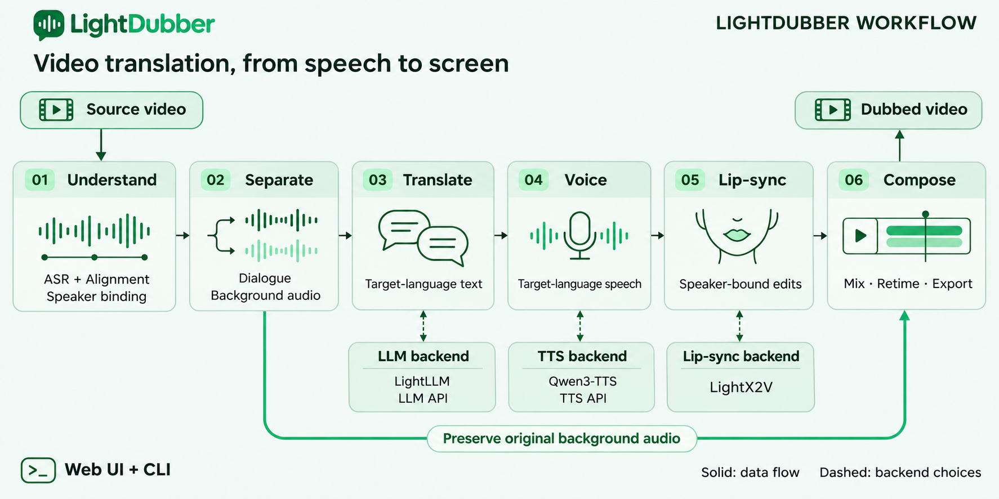

<p align="center">
  <picture>
    <source media="(prefers-color-scheme: dark)" srcset="docs/assets/lightdubber-logo-v3-dark.png" />
    
  </picture>
</p>

<h3 align="center">面向多人、多镜头视频的端到端译制。</h3>

<p align="center">
  多人对白翻译、角色声音克隆与口型同步，衔接镜头切换。<br />
  根据译音自适应调整时长，混合原片背景声，让声音与画面协同呈现。
</p>

<p align="center">
  <a href="README.md">English</a> · <strong>简体中文</strong>
</p>

<p align="center">
  <a href="#quick-start"></a>
  <a href="#features"></a>
  <a href="https://github.com/ModelTC/LightX2V"></a>
</p>

<p align="center">
  <a href="#features">功能特性</a> ·
  <a href="#demo">效果展示</a> ·
  <a href="#pipeline">处理流程</a> ·
  <a href="#quick-start">快速开始</a> ·
  <a href="docs/installation.zh-CN.md">安装与 API 配置</a>
</p>

---

**LightDubber** 是面向**多人对话、角色反复出镜与镜头切换**的开源视频译制框架。它将“谁说了什么”与“画面中是谁”关联起来，完成上下文翻译、角色配音和对应人物的口型同步；既可保持原片时长，也可让符合条件的片段随译音节奏调整。

从访谈、对话场景到单人口播，LightDubber 将译文、声音、口型和时长纳入同一条自动化流程。可使用本地模型，也可独立接入翻译与 TTS API；各阶段通过统一接口替换模型，方便扩展。

<a id="features"></a>
## 功能特性

| 核心能力 | 解决什么问题 |
| :-- | :-- |
| **多人对白处理** | 结合声音、人脸身份与画面中的说话动作，将对白关联到对应角色。 |
| **跨镜头角色关联** | 匹配在不同镜头中出现的同一角色，按镜头边界规划口型编辑。 |
| **上下文翻译** | 结合前后对白与说话人历史，翻译为 10 种目标语言，默认自动识别源语言。 |
| **角色配音与口型同步** | 使用对应角色的参考音频进行本地声音克隆，再通过 LightX2V 用译音驱动对应人物的口型。 |
| **自适应时长** | 可保持原视频时长，也可延长或缩短符合条件的片段，让画面适配译音。 |
| **原片背景氛围** | 分离对白与背景声，将新配音与原片音乐、环境声重新混合。 |
| **本地模型与 API** | 翻译、TTS 可分别选择本地模型或 API，各阶段模型可独立替换，无需重写流程。 |
| **网页与命令行** | 上传视频、任务排队、预览成片，也可通过 CLI 自动执行同一条流程。 |

**支持语言：** 中文 · 英语 · 日语 · 韩语 · 德语 · 法语 · 俄语 · 葡萄牙语 · 西班牙语 · 意大利语

<a id="demo"></a>
## 效果展示

**中文 → 英语**

<table>
<thead>
<tr>
<th align="center" width="50%">原视频 · 中文</th>
<th align="center" width="50%">LightDubber · 英语</th>
</tr>
</thead>
<tbody>
<tr>
<td width="50%" align="center" valign="top">

https://github.com/user-attachments/assets/83d17d3e-f1da-455e-b217-6ded433ff221

</td>
<td width="50%" align="center" valign="top">

https://github.com/user-attachments/assets/ffc9e8b9-be30-41cf-aec9-19c4e5c4f54e

</td>
</tr>
</tbody>
</table>

<a id="pipeline"></a>
## 处理流程

<p align="center">
  
</p>

**让译文、角色声音、人物口型与视频时长，在同一条流程中协同。**

1. **跨镜头理解对话。** 检测镜头边界、提取对白与时间信息，将台词关联到反复出镜的角色。
2. **按角色翻译与配音。** 结合对话上下文翻译每句台词，通过本地声音克隆或选定的 TTS API 生成目标语言语音。
3. **同步对应人物的口型。** 用译音驱动匹配人物的嘴部动作，将编辑区域融合回原镜头。
4. **让成片适配译音。** 混合原片背景声，选择保留原时长，或同步调整符合条件的画面与音轨片段，使其适配译音节奏。

<details>
<summary>时长模式与配音选择</summary>

**固定时长**将译音适配到原时间线。**自适应时长**可延长或缩短单镜头内、没有其他对白重叠的独立片段，并同步调整视频与音轨；跨镜头或存在对白重叠的片段保持原时长。

本地 Qwen3-TTS 在有合适角色参考音频时支持声音克隆；API TTS 使用服务商提供的预设音色。没有可靠可见人脸的对白只做配音，不编辑口型。

</details>

<a id="quick-start"></a>
## 快速开始

需要 **Linux、CUDA GPU、FFmpeg、`curl`、`unzip` 和 `uv`**。以下示例使用本地翻译与 TTS。**翻译也可调用 DeepSeek、OpenAI GPT 等 OpenAI 兼容 API**，无需本地 LightLLM/vLLM 环境、Qwen3.5 权重和翻译 GPU，配置见 [API 安装与示例](docs/installation.zh-CN.md#api-backends)。

### 1. 安装环境

```bash
git clone https://github.com/ModelTC/LightDubber.git
cd LightDubber
bash scripts/install.sh --translation lightllm
```

安装脚本准备主管线和本地 TTS 环境；`--translation lightllm` 同时安装本地翻译服务。当前 Qwen3-TTS 与主管线需要的 Transformers 版本不同，因此本地 TTS 保留独立 Python 环境，由脚本自动管理。使用 API TTS 时可通过 `--tts api` 跳过这个环境。

口型编辑需要安装支持原生 TBDub 的 [LightX2V](https://github.com/ModelTC/LightX2V)。提交任务前，请完成[模型服务配置](docs/installation.zh-CN.md#model-services)。

### 2. 下载模型并生成配置

```bash
export MODEL_DIR=/path/to/models/video_dubbing
PYTHON_BIN="$PWD/.venv/bin/python" bash scripts/download_models.sh all
.venv/bin/python scripts/configure.py --models "$MODEL_DIR" --output config.local.json
```

[config.example.json](config.example.json) 列出了模型路径和后端选项，生成的本地配置不会被 Git 跟踪。单独下载组件或切换下载源，请参阅[模型下载](docs/installation.zh-CN.md#model-downloads)。

### 3. 启动模型服务

在独立终端中启动 [LightLLM 和 LightX2V](docs/installation.zh-CN.md#model-services)。文档示例使用 GPU 0 运行翻译、GPU 1 运行口型编辑、GPU 2–3 运行管线 worker；请根据机器调整卡号与模型路径。

| 服务 | 默认地址 |
| :-- | :-- |
| 翻译 · LightLLM | `http://127.0.0.1:18440/v1` |
| 口型编辑 · LightX2V | `http://127.0.0.1:18441` |

### 4. 翻译视频

模型服务就绪后启动网页：

```bash
DUB_GPUS=2,3 DUB_CONFIG="$PWD/config.local.json" \
  DUB_DATA_DIR="$PWD/outputs/web" bash scripts/serve.sh
```

打开 **http://127.0.0.1:18320**，等待 worker 加载模型后，上传视频并选择目标语言。只启动一个管线 worker 时，设置 `DUB_GPUS=2`。

也可以在空闲的管线 GPU 上使用命令行：

```bash
.venv/bin/python main.py \
  --config config.local.json --gpu 2 \
  --source input.mp4 --target-language en \
  --output outputs/example_en
```

时长模式、上传、公网访问和任务续跑见[使用选项](docs/installation.zh-CN.md#usage-options)。

## 输出与开发

每个任务生成 `final.mp4`、`source.txt`、`translated.txt`、`report.json` 和运行日志；报告中分别统计翻译和 TTS 耗时。网页任务保存在 `$DUB_DATA_DIR/jobs/<id>/`。

<details>
<summary>目录结构与阶段接口</summary>

```text
main.py                  命令行入口
runtime/                 管线、配置、客户端与常驻模型进程
stages/
  prepare/               视频与音频标准化
  recognition/           ASR、对齐、声学说话人标签
  speakers/              人脸检测、活跃说话人、身份绑定
  separation/            对白与背景分离
  speech/                翻译与语音合成
  lipsync/               裁剪规划与 LightX2V 请求
  postprocess/           混音、回贴、时长调整与导出
web/                     上传、任务队列、结果查看
scripts/                 安装、下载与服务启动脚本
```

CLI 和网页 worker 共用 `Pipeline`。模型阶段在 `run.py` 暴露 `run_stage(...)`，在 `model.py` 放模型或服务适配，在 `utils.py` 放工具函数；导出阶段按音频、视频职责组织模块。`runtime/paths.py` 统一管理任务文件路径。S3FD、LoCoNet 和 SAM-Audio 推理代码放在使用它们的阶段目录内。

TTS 对相同请求复用已有音频，并停止不再改善时长的缩短重试。人脸检测缓存固定形状的先验框，并行处理帧编码与检测。CPU 回归测试覆盖缓存、阶段调度和任务续跑：

```bash
.venv/bin/python -m unittest discover -s tests -v
```

</details>

## 致谢

项目基于 [LightX2V](https://github.com/ModelTC/LightX2V)、[LightLLM](https://github.com/ModelTC/LightLLM) 及 [SOURCES.json](SOURCES.json) 中列出的上游模型构建，原始许可证与声明保留在 [licenses/](licenses/) 中。本地翻译也可使用 [vLLM](https://github.com/vllm-project/vllm) 后端。
