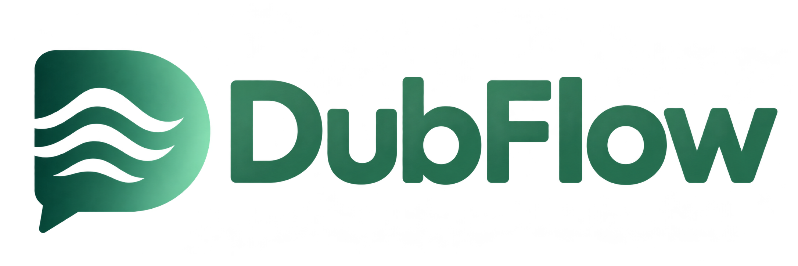
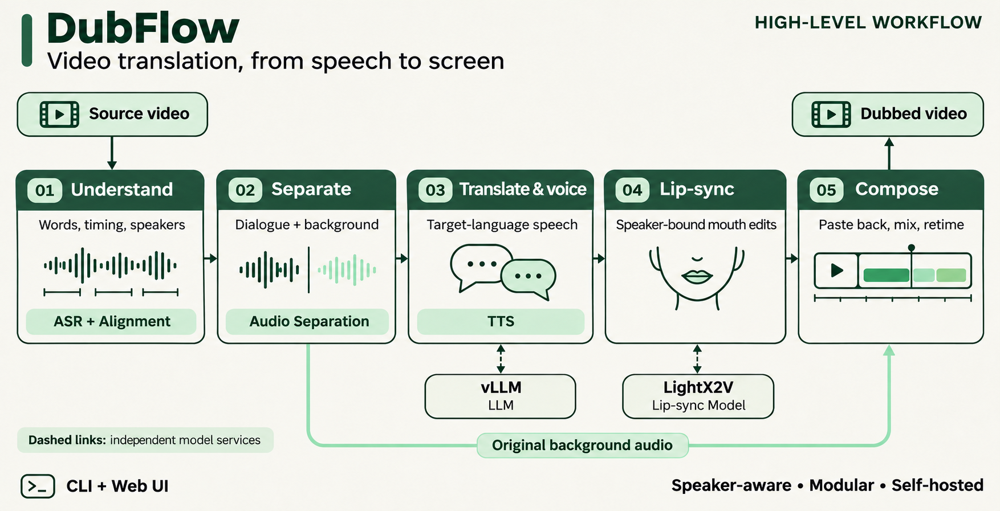

  

<h3 align="center">理解谁在说话，让视频跨越语言</h3>

  <a href="README.md">English</a> · <strong>简体中文</strong>

  
  
  
  

  <a href="#showcase">效果展示</a> ·
  <a href="#pipeline">处理流程</a> ·
  <a href="#quick-start">快速开始</a> ·
  <a href="#deployment">模型服务</a> ·
  <a href="#usage">网页与命令行</a>

---

**DubFlow** 是面向**多人对话与多语言创作**的强大视频译制框架。融合说话人感知的音色克隆、局部口型同步与自适应时长，让跨语言表达兼顾人物身份、原片风格和对白节奏。从单人口播到多人互动，上传视频，即可让你的故事跨越语言边界。

**支持语言：** 中文 · 英语 · 日语 · 韩语 · 德语 · 法语 · 俄语 · 葡萄牙语 · 西班牙语 · 意大利语  
源语言默认自动识别，目标语言由用户指定。

## 效果展示 · 中文 → 英文

<!-- 将手动上传的视频链接或带链接的缩略图填入下方单元格。 -->

| 原视频 · 中文 | DubFlow · 英文 |
| :---: | :---: |
| <!-- 中文原视频 --> | <!-- 英文译制视频 --> |

<!-- 可选：填入同一案例的一小段对白，展示翻译前后的内容。 -->

| 原文 · 中文 | 译文 · English |
| --- | --- |
| <!-- 原文台词 --> | <!-- 英文译文 --> |

## 处理流程

  

**ASR 与时间对齐**提供原文和时间信息，音视频联合的**说话人绑定**将台词关联到画面人物。**音源分离**拆分对白与背景；由 **vLLM** 提供服务的 **LLM** 完成翻译，**TTS** 生成目标语言配音，**LightX2V** 承载口型同步模型，局部编辑人物嘴部。最后回贴画面、混合译音与背景声并输出。这里描述模块职责，不绑定具体模型；当前使用的实现见下方安装部署说明。

> 识别、翻译、分离与口型均受模型能力影响，不保证逐字准确、背景完全干净或完美同步。没有可绑定的可见人物时，仅替换音频，不强行修改其他人的嘴；模型执行异常则报告失败。

## 快速开始

### 1. 准备环境

需要 Linux、CUDA GPU、FFmpeg、`curl`、`unzip` 和 `uv`。以下命令均在仓库根目录运行：

~~~bash
git clone https://github.com/ModelTC/DubFlow.git
cd DubFlow

# 主管线：识别、分离、人物绑定和网页
bash scripts/install_unified.sh "$PWD/.venv"

# Qwen3-TTS：隔离的 Transformers 4.57 环境
uv venv --python 3.11 .venv-tts
uv pip install --python .venv-tts/bin/python \
  --index-url https://download.pytorch.org/whl/cu128 \
  torch==2.8.0+cu128 torchaudio==2.8.0+cu128
uv pip install --python .venv-tts/bin/python \
  qwen-tts==0.1.1 transformers==4.57.3 accelerate==1.12.0 soundfile

# 翻译服务
uv venv --python 3.11 .venv-vllm
uv pip install --python .venv-vllm/bin/python vllm==0.23.0
~~~

另在独立环境中，按仓库说明安装**已支持原生 TBDub 推理的 [LightX2V](https://github.com/ModelTC/LightX2V)**。该环境还需安装 `scikit-image`，用于色彩校正。

这些环境因依赖约束而分开，不要混装。主环境安装脚本会建立 FFmpeg 动态库链接；管线启动各阶段时自动设置库搜索路径。

### 2. 下载模型

受限模型需先接受访问条款，必要时运行 `.venv/bin/hf auth login` 登录。不要将 Token 写入源码。

~~~bash
export MODEL_DIR=/path/to/models/video_dubbing
PYTHON_BIN="$PWD/.venv/bin/python" bash scripts/download_models.sh all
~~~

脚本下载当前流程所需模型及辅助权重，仓库本身不包含权重。SAM-Audio Large-TV 默认从 ModelScope 下载；设置 `SAM_AUDIO_DOWNLOAD_SOURCE=hf` 可改用 Hugging Face。

按组件单独下载

~~~bash
# 将 all 替换为以下分组之一：
# core                 TBDub Student、VAE、HuBERT、人物检测/几何/身份模型
# speech               Qwen ASR、ForcedAligner、Nemotron、Qwen3-TTS
# loconet              UniTalk-LoCoNet 发言检测权重
# sam-audio            SAM-Audio Large-TV 及文本编码器
# qwen35-translation   Qwen3.5-9B
PYTHON_BIN="$PWD/.venv/bin/python" bash scripts/download_models.sh sam-audio
~~~

### 3. 生成本机配置

~~~bash
.venv/bin/python scripts/configure.py \
  --models "$MODEL_DIR" \
  --python "$PWD/.venv/bin/python" \
  --tts-python "$PWD/.venv-tts/bin/python" \
  --output config.local.json
~~~

模板见 [config.example.json](config.example.json)。本机配置已被 Git 忽略；确实需要覆盖已有配置时，再加 `--force`。

## 启动模型服务

下面以四张显卡为例：

| 显卡 | 进程 | 职责 |
| :-- | :-- | :-- |
| 0 | vLLM | Qwen3.5-9B 翻译 |
| 1 | LightX2V | TBDub Student 口型编辑 |
| 2、3 | DubFlow worker | 每个 worker 处理一个视频；TTS 在同卡独立常驻进程中运行 |

各命令在不同终端、DubFlow 根目录执行。每个终端都要将 `MODEL_DIR` 设置为实际模型目录，并替换 LightX2V 的安装路径。

**终端 1 — 翻译服务**

~~~bash
GPU_ID=0 MODEL_PATH="$MODEL_DIR/Qwen3.5-9B" \
  VLLM_BIN="$PWD/.venv-vllm/bin/vllm" \
  bash scripts/serve_translation.sh
~~~

**终端 2 — 口型服务**

~~~bash
GPU_ID=1 LIGHTX2V_PATH=/path/to/LightX2V \
  PYTHON_BIN=/path/to/lightx2v-env/bin/python \
  MODEL_PATH="$MODEL_DIR/tbdub" \
  CONFIG_PATH="$PWD/configs/tbdub_server.json" \
  bash scripts/serve_lipsync.sh
~~~

默认接口分别为 `http://127.0.0.1:18440/v1` 和 `http://127.0.0.1:18441`，对应配置中的 `translation_url`、`tbdub_url`。

**LightX2V 和 DubFlow 必须能够访问相同的媒体绝对路径**，容器部署时也一样。两个模型接口应保持内网可用，不要直接暴露公网。显存需求取决于模型和输入，上面的显卡分配仅为部署示例，不代表最低显存承诺。

## 开始翻译

### 网页

**终端 3 — 网页和常驻管线 worker**

~~~bash
DUB_GPUS=2,3 DUB_CONFIG="$PWD/config.local.json" \
  DUB_DATA_DIR="$PWD/outputs/web" bash scripts/serve.sh
~~~

打开 **http://127.0.0.1:18320**，等待模型加载完成后上传视频、选择目标语言。两个 worker 可并行处理两个视频；共享口型服务对裁脸任务排队执行。仅需一个管线 worker 时，设置 `DUB_GPUS=2`。

可选：临时公网 HTTPS 链接

先安装 `cloudflared`，然后运行：

~~~bash
CLOUDFLARED_BIN=/path/to/cloudflared PORT=18320 bash scripts/public.sh
~~~

使用终端打印的 HTTPS 地址。拿到链接的人可以上传并触发推理，仅分享给允许使用的用户；停止隧道进程后取消访问。不要公开 vLLM 或 LightX2V 模型接口。

默认单文件上限为 250 MB，分块为 32 MiB。启动网页时可通过 `DUB_MAX_UPLOAD_MB`、`DUB_UPLOAD_CHUNK_MB` 调整。

### 命令行

先启动两个模型服务，选择未被网页 worker 占用的空闲管线显卡：

~~~bash
.venv/bin/python main.py \
  --config config.local.json --gpu 2 \
  --source input.mp4 --target-language en \
  --output outputs/example_en
~~~

| 参数 | 行为 |
| :-- | :-- |
| `--target-language en` | 必填目标语言：`zh/en/ja/ko/de/fr/ru/pt/es/it` |
| `--source-language zh` | 手动指定源语言，覆盖自动识别 |
| `--duration-mode adaptive_video` | 符合条件的画面与背景声片段随译音调整时长，默认配置 |
| `--duration-mode fixed` | 保持原视频时长，让译音适配说话时窗 |
| `--resume` | 续跑相同请求；改输入或配置后请使用新输出目录 |

### 结果与日志

- `final.mp4` — 最终视频；自适应模式下的 `final_fixed.mp4` 是调时长前的中间版本。
- `source.txt` / `translated.txt` — 识别原文与实际译文。
- `report.json` — 音频替换和口型编辑结果。
- `run.json` / `logs/` — 流程进度和各阶段错误。

网页任务位于 `$DUB_DATA_DIR/jobs/<id>/`，常驻模型加载日志位于 `$DUB_DATA_DIR/resident/`。在各服务启动终端使用 `Ctrl+C` 停止。

代码结构

~~~text
main.py                  按顺序编排流程
stages/
  prepare.py             视频与音频规范化
  recognition/           识别、时间对齐、声学说话人标注
  speakers/              检测人物、判断发言、绑定身份
  separate.py            分离对白和背景
  speech/                翻译与配音
  lipsync/               规划裁剪、调用 LightX2V
  output/                混音、回贴、调整时长、导出
runtime/                 配置、服务客户端、常驻进程
web/                     上传、排队、结果展示
scripts/                 安装、下载、服务启动脚本
~~~

CLI 与网页 worker 共用 `main.py`。可通过 `python -m stages.<module> --help` 查看独立阶段参数。

---

基于 [LightX2V](https://github.com/ModelTC/LightX2V)、[vLLM](https://github.com/vllm-project/vllm) 及 [third_party/SOURCES.json](third_party/SOURCES.json) 记录的上游模型与组件构建。原始许可及必要署名保留在 [third_party/](third_party/) 和 [licenses/](licenses/)。模型与素材的使用权限需分别遵守；声音克隆须获得相应授权。

<a href="#pipeline">回到流程图 ↑</a> · <a href="README.md">English</a>

